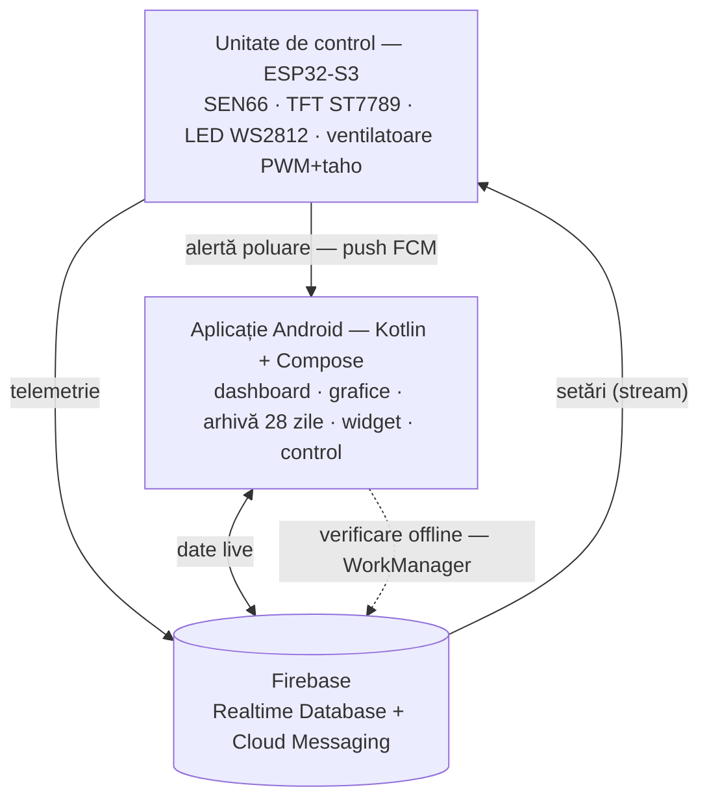

# Smart Air — Purificator de aer inteligent (DIY)


> ### © 2026 Cosmin Olaru — Toate drepturile rezervate (All Rights Reserved)
>
> Întregul conținut al acestui depozit — codul sursă (firmware ESP32-S3 și aplicația
> Android), designul hardware și software, interfețele grafice și documentația — constituie
> **proprietatea intelectuală exclusivă a autorului**. Materialul este publicat **strict în
> scop de prezentare** pentru lucrarea de licență.
>
> **NU se acordă nicio licență** de utilizare, copiere, modificare, redistribuire sau
> exploatare comercială. Orice astfel de utilizare, integrală sau parțială, necesită acordul
> scris, prealabil și explicit al autorului. Toate drepturile sunt rezervate, inclusiv în
> vederea unei posibile comercializări viitoare a produsului.

**Smart Air** este un sistem IoT complet de monitorizare și purificare a aerului interior,
dezvoltat ca proiect de licență. Combină o cutie de filtrare DIY tip **Corsi–Rosenthal** cu o
unitate de control **ESP32-S3** (senzor de calitate a aerului, ecran TFT, control inteligent al
ventilatoarelor) și o **aplicație Android** companion, sincronizate în timp real prin Firebase și
notificări push FCM.

---

## Cuprins
- [Funcționalități](#funcționalități)
- [Arhitectură](#arhitectură)
- [Hardware](#hardware)
- [Structura depozitului](#structura-depozitului)
- [Configurare (date private)](#configurare-date-private)
- [Compilare și rulare](#compilare-și-rulare)
- [Tehnologii](#tehnologii)
- [Context academic](#context-academic)

---

## Funcționalități

**Monitorizare**
- Dashboard live: PM1.0 / PM2.5 / PM4.0 / PM10, CO₂, indice VOC, indice NOx, temperatură,
  umiditate și turația ventilatoarelor (RPM)
- Grafice istorice interactive (4h / 12h / 24h) și **arhivă pe 28 de zile**
- **Scor zilnic** al calității aerului, export CSV

**Purificare inteligentă**
- Mod **AUTO** al ventilatoarelor cu histerezis asimetric (praguri inspirate din ghidurile EPA
  pentru PM2.5) — pornește repede la poluare, se oprește lent pentru stabilitate
- Control manual al vitezei direct din aplicație sau de pe placă

**Interfață și alerte**
- Ecran **TFT ST7789** „flicker-free" pe placă + **LED RGB WS2812** de stare
- **Widget** de home screen cu indicator de vechime a datelor
- Notificări push: praguri de poluare (trimise **direct de placă** prin FCM) și **dispozitiv offline**

**Fiabilitate**
- Actualizare **OTA**, **watchdog** hardware, salvare locală a istoricului fără WiFi și
  re-sincronizare la reconectare
- Calibrări senzor conform datasheet-ului SEN66: **FRC pentru CO₂** și **reset stare VOC**
- Mod de noapte programabil (enforcement pe placă)

---

## Arhitectură



**Flux de date**
- Placa citește senzorul SEN66 și **publică telemetria** în Realtime Database; aplicația o
  afișează live (stream RTDB).
- Setările (praguri, mod AUTO, mod de noapte) se scriu din aplicație în RTDB; placa le preia
  printr-un **stream** + un poll de siguranță la 60 s.
- La depășirea pragurilor, **placa trimite singură** notificarea FCM (HTTP v1) — fără serviciu
  de fundal permanent în aplicație.
- Un **WorkManager** în aplicație verifică periodic prospețimea datelor (citire REST directă din
  RTDB) și alertează dacă dispozitivul a căzut.

---

## Hardware

| Componentă | Detalii |
|---|---|
| **ESP32-S3** (WROOM, PSRAM OPI, flash mare) | Microcontroler principal, WiFi, OTA |
| **Sensirion SEN66** | Senzor combo: particule (PM1–PM10), CO₂, VOC, NOx, temperatură, umiditate |
| **Ecran TFT ST7789 2.0"** | Afișaj local al valorilor în timp real |
| **LED WS2812 (NeoPixel)** | Indicator RGB de stare a calității aerului |
| **5 × ventilatoare Arctic P14 Pro Pst** | Flux de aer reglabil + citire turație (tahometru) |
| **4 × filtre IKEA Starkvind** | Mediu de filtrare (eficiență ~99,5% pentru PM2.5) |
| **Cutie Corsi–Rosenthal** | Structura DIY care leagă filtrele și ventilatoarele |

**Performanță estimată:** CADR ≈ **555 m³/h** la turație maximă — în clasa purificatoarelor comerciale premium.

---

## Structura depozitului

```
SmartAir/
├── firmware/                     # Cod ESP32-S3 (Arduino / C++)
│   ├── Esp_SmartPurifier.ino
│   └── secrete.h.example         # Șablon credențiale (fără date reale)
└── android/                      # Aplicație Android (Kotlin + Jetpack Compose)
    ├── app/src/main/java/com/example/smartpurifier/MainActivity.kt
    └── secrete.properties.example
```

---

## Configurare (date private)

> ⚠️ Depozitul **nu conține** niciun secret. Toate credențialele (chei API, cont Firebase,
> parole WiFi/OTA, cheia de service account FCM) sunt externalizate în fișiere ignorate de git.
> Pentru a compila proiectul, creează-le din șabloanele `.example`:

**Firmware** — `firmware/`
1. Copiază `secrete.h.example` → `secrete.h`.
2. Completează cu datele proiectului tău Firebase: API key, URL bază de date, cont email/parolă,
   parolă OTA, rețelele WiFi și (opțional) cheia de service account pentru notificările FCM.

**Android** — `android/`
1. Copiază `secrete.properties.example` → `secrete.properties` (în rădăcina `android/`) și
   completează `smartair.dbUrl`, `smartair.fbEmail`, `smartair.fbPass`.
2. Adaugă propriul `app/google-services.json` (Firebase Console → Project settings → Your apps).

---

## Compilare și rulare

**Firmware** (Arduino IDE 2 + core ESP32, placă ESP32-S3)
Biblioteci necesare: Adafruit GFX, Adafruit ST7735/ST7789, Adafruit NeoPixel,
Sensirion I²C SEN66, Firebase ESP Client (Mobizt).

**Android**
```bash
cd android
./gradlew :app:assembleDebug
```
sau deschide folderul `android/` direct în Android Studio.

---

## Tehnologii

- **Firmware:** C++ / Arduino, FreeRTOS, Firebase ESP Client, FCM HTTP v1, OTA
- **Aplicație:** Kotlin, Jetpack Compose, WorkManager, Firebase Realtime Database & Messaging
- **Cloud:** Firebase Realtime Database + Cloud Messaging
- **Senzoristică:** Sensirion SEN66 (I²C)

---

## Context academic

Cod sursă complet pentru lucrarea de licență **„Smart Air"** (Facultatea de Automatică,
Calculatoare și Electronică, Universitatea din Craiova). Arhitectura, deciziile de proiectare și
fragmentele de cod relevante sunt detaliate în lucrarea scrisă.

---

<sub>© 2026 Cosmin Olaru. Toate drepturile rezervate. Acest cod este publicat exclusiv în scop de
prezentare academică — vezi nota de copyright de la începutul fișierului.</sub>
